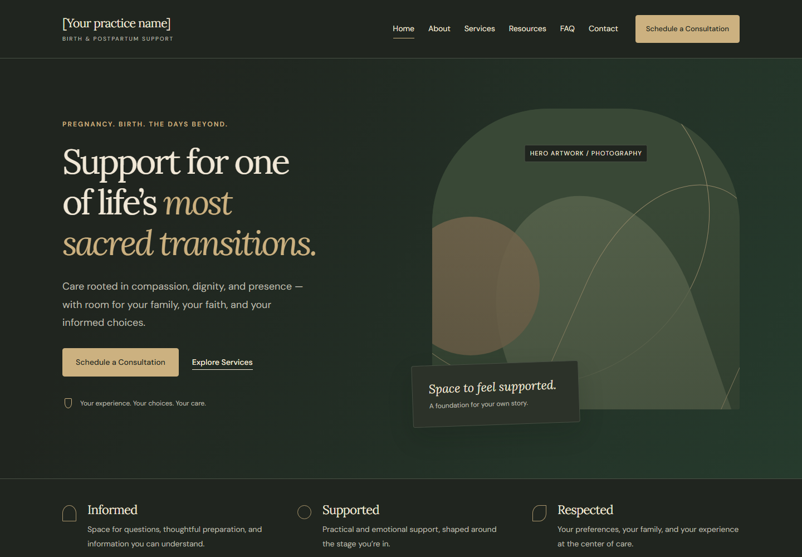

# Doula care website template



A local, reusable React + TypeScript/Vite foundation for Resistance & Ground. This is deliberately a template, with no invented practice, practitioner, credentials, reviews, prices, or location.

The current visual direction is dark, warm, and editorial: forest green, warm charcoal, umber, muted burgundy, antique gold, and ivory. Cream form, article, and expanded FAQ surfaces preserve reading comfort. `src/atmosphere.css` contains the visual treatment; `src/styles.css` retains the layout foundation. Both use the central theme tokens.

## Optional faith-sensitive tone

`site.faithTone` defaults to `true` for this gallery variation. Set it to `false` for a fully secular presentation: the neutral hero and contact copy return, the About faith/calling placeholder disappears, and the reflective values, optional quote, and faith-related FAQ are omitted. The layout, colors, services, routes, form, and booking flow continue to work unchanged. This switch is a build-time content choice; rebuild after changing it.

Everything related to that tone lives under `site.faith`: alternate hero wording, optional About copy, contact subcopy, editable reflective values, quote settings, and the optional FAQ. There is no required religion, theological claim, personal testimony, or default scripture.

`faith.reflection.enabled` and `faith.faq.enabled` independently control those elements. `faith.quote.enabled` is `false` by default. The reusable `QuoteBlock` accepts a kind (`reflection`, `scripture`, `poetry`, or `quotation`), an eyebrow, text, and optional attribution. Only a clearly bracketed placeholder is supplied; add approved client-selected text and attribution before enabling it. In the faith-sensitive layout, `faithTone: false` hides the quote even if its own switch is enabled. The component can also be reused independently for a secular quotation.

FAQ structured data uses the same `activeFAQs()` source as the visible accordion, including the tone switch, when FAQ schema is enabled. The shipped business/FAQ schema switches remain off until real client content is reviewed.

## Run locally

Requires Node.js 20.19+ or 22.12+ and npm.

```powershell
cd path\to\doula-care-template
npm install
npm run dev
```

Open the local URL printed in the terminal. Opening `index.html` as a `file://` URL will not run React/TypeScript. To inspect production output, use `npm run build` then `npm run preview`.

This repository contains the template source. The public gallery demo is published with GitHub Pages at [sevenfiresburning.github.io/rg-doula-care-template](https://sevenfiresburning.github.io/rg-doula-care-template/).

## Start with `src/config.ts`

All editable identity, copy, navigation, CTAs, services, FAQs, resources, testimonials, contact information, theme values, and SEO settings live in the exported `site` object. No branding is copied from another gallery demo.

| Change | Config section |
| --- | --- |
| Practice name, practitioner, verified credentials, contact and location | `brand` |
| Primary and secondary calls to action | `cta` |
| External booking link | `brand.bookingUrl` (empty uses `/contact`) |
| Logo and social links | `brand.logo`, `brand.logoAlt`, `brand.socials` |
| Colors, fonts, radii, spacing, shadows, image masks, decoration opacity | `theme` |
| Main art, portrait, editorial strip, supporting image | `images` |
| Service cards, inclusions, audiences, packages, ordering | `services` |
| Header/footer links and copy | `navigation`, `footer` |
| Process, FAQ, home and About copy | `process`, `faq`, `hero`, `bio`, `headings`, `closing` |
| Article cards, category filters, full article text | `resources`, `resourceCategories` |
| Form endpoint, text and privacy notice | `form`, `contact` |
| Domain, metadata, indexing, business/FAQ schema switches | `seo`, `pageMeta` |

### Services

Six foundational examples are enabled. The four optional services are present with `enabled: false`. Set any service to false to remove it from the overview, details, jump links, form options, and service schema. There is no required service or fixed service count.

- `featured` selects cards for the home page.
- `homeDetail` selects the long-form home sections.
- `packageNote` is optional and absent by default. Add only real client-approved package or pricing information.
- `image` configures each service's replaceable art/photo.

### Art and photography

Every slot accepts `{ src, alt, srcSet?, position?, tone, label }`. Place your image files in `public/images` and set `src: '/images/your-file.webp'`. Add meaningful `alt` text for informative photography; use an empty string for decorative photography. Supply optimized WebP/AVIF variants with `srcSet` if available. The component includes responsive `sizes`, reserved aspect ratios, lazy loading below the fold, and priority loading for the hero.

An empty `src` renders removable CSS abstract artwork, with no remote image dependency. `label` identifies the placeholder. The hero, practitioner portrait, service images, editorial strip, testimonial images, and resource thumbnails all use the same `ImageArtSlot` component. Turn down `theme.layout.decorativeOpacity` or replace a slot to remove the base art. CSS artwork is decorative and hidden from assistive technology.

`theme.fonts.stylesheet` configures the font stylesheet; `heading` and `body` configure font-family stacks. System fallbacks keep the site usable offline. `theme.art` holds every abstract-art palette. Layout, card shadows, image masks, section spacing, and button shapes are CSS variables derived from config. Use `src/styles.css` for deeper design changes.

### Testimonials and credentials

`brand.credentials` and `testimonials` are empty. Do not insert sample claims as real content. Empty credentials show an explicit placeholder. Empty testimonials show a labeled preview only in development and are omitted from production HTML. A testimonial is rendered only when `consentConfirmed: true`. Its optional `image` uses the same replaceable image slot. No review or aggregate-rating schema is emitted.

### Resources

The six starter cards lead to real template article routes. Their placeholder status is visible, `published: false` prevents indexing and Article schema, and the copy makes no educational/medical claims. Replace each article with reviewed original content, set its accurate date, then set `published: true`. Categories are configurable, not tied to a fixed count.

### Consultation form

The default `form.endpoint: ''` is an explicit demo mode: native validation works, no request is sent, no data is stored, and the confirmation says so. Required fields are name/email, plus phone when phone is selected as the preferred contact method. Due date and message are optional. Service options come only from enabled services.

To connect a real form, set your HTTPS endpoint, method (POST), success/error copy, response-time text, and privacy notice. The endpoint receives JSON keys `name`, `email`, `phone`, `dueDate`, `interest`, `preference`, `message`, and the configured honeypot field. Any HTTP 2xx is treated as success; other responses/network failures show the error state and preserve entries. Requests time out after 15 seconds; duplicate submissions are blocked while pending.

The honeypot is a hook, not a complete anti-spam system. Implement server validation, rate limiting, spam checks, allowed origins, and data handling in your chosen endpoint. `csrfToken` optionally supplies an `X-CSRF-Token` header; issue/verify it server-side if your endpoint requires it. Never put secrets in this public config. This template does not choose a third-party form service.

### Routes and SEO

Main routes: `/`, `/about`, `/services`, `/resources`, `/faq`, `/contact`. Resource details use `/resources/:slug`; unknown paths show a friendly not-found page.

`npm run build` type-checks, builds a small client bundle, builds a local SSR renderer, and prerenders every route into `dist/<route>/index.html`. Text, headings, links, metadata, and JSON-LD are present in the built HTML without JavaScript. The build also creates `404.html`, `robots.txt`, and `sitemap.xml`.

The reserved placeholder `https://your-domain.example` demonstrates absolute canonical/OG URLs without inventing a domain. The template ships `noindex,nofollow` and a disallow-all robots policy. Before a real launch, supply the real domain and client metadata, replace placeholders, review content and permissions, then set `seo.indexable: true`. Set `enableBusinessSchema` and `enableFAQSchema` only after the identity, training, location, services, and answers are accurate. Person, ProfessionalService, Service, FAQPage, Article, WebSite, and BreadcrumbList are supported; no medical schema is used.

`public/social-preview.png` is a real 1200×630 social image. Its editable vector source is `public/social-preview.svg`. Replace both and update `seo.image`, `seo.imageAlt` for a client; keep the URL absolute after resolution against `seo.siteUrl`. To regenerate the default PNG and QA screenshots while the dev server runs on 5188, run `node scripts/capture-preview.mjs`. Google/social crawlers should use the prerendered production output, not the Vite development server.

The GitHub Pages workflow in `.github/workflows/pages.yml` builds and deploys the demo when `codex/doula-care-template` is updated. `VITE_BASE_PATH` sets the project prefix; `VITE_SITE_URL` sets the absolute canonical/social base URL. Internal links, imagery, client routes, and prerendered metadata honor these settings. Local development still defaults to `/`. For another host, select static directory-index support and serve `404.html` with an HTTP 404 for unknown paths.

## Verification

```powershell
npm run check
npm run build
npx playwright install chromium
npm test
```

Browser checks cover all routes at desktop/tablet/mobile widths, no horizontal overflow, CTA and navigation links, service anchors, keyboard FAQ interactions, mobile menu Escape/focus behavior, resource filtering, form validation, demo confirmation, configured endpoint success/error handling, and reduced motion. See `QA.md` for observed results and limits.

All code and assets belong to this folder. No other demo or game repository is needed.
